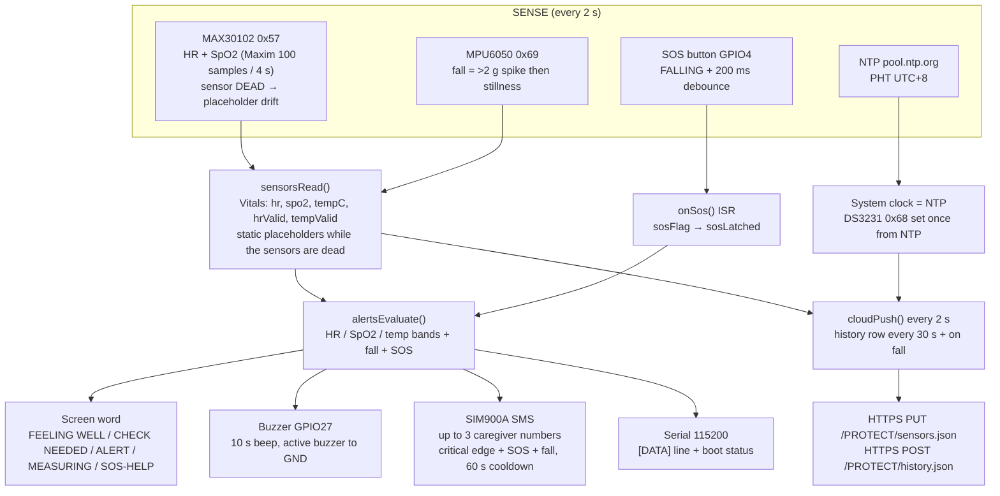
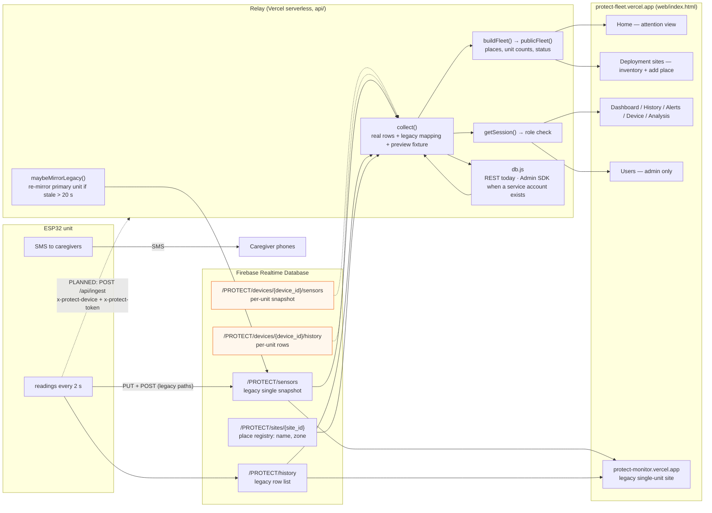
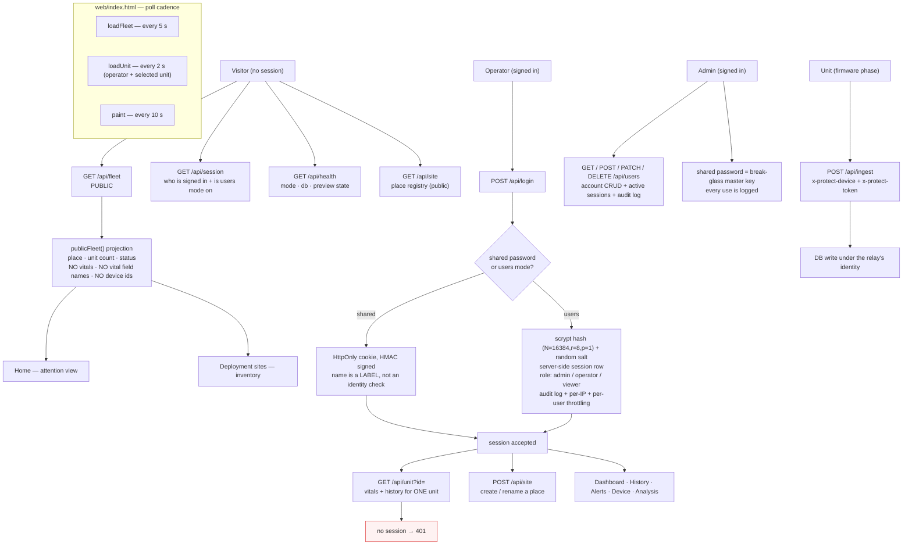

# System Flow — P.R.O.T.E.C.T.

What the unit does, what it sends, who can see it, and what is not wired yet.
Every arrow below was checked against the code (files listed at the end).

**Legend:** solid = live now · dashed = specified and documented, not running
yet · amber = known gap.

**Download the images** (PNG = white background for documents, SVG = vector,
scales without blurring):

| Diagram | PNG | SVG |
|---|---|---|
| 1. The unit | [01-unit.png](diagrams/01-unit.png) | [01-unit.svg](diagrams/01-unit.svg) |
| 2. End to end | [02-end-to-end.png](diagrams/02-end-to-end.png) | [02-end-to-end.svg](diagrams/02-end-to-end.svg) |
| 3. Website and relay | [03-website-relay.png](diagrams/03-website-relay.png) | [03-website-relay.svg](diagrams/03-website-relay.svg) |

Regenerate them after editing a diagram:

```bash
npm install @mermaid-js/mermaid-cli@11.9.0        # once
# split the mermaid blocks out of this file, then:
mmdc -i diagram.mmd -o docs/diagrams/name.svg -b transparent
mmdc -i diagram.mmd -o docs/diagrams/name.png -b white -s 2
```

---

## 1. The unit (ESP32)

Sensors in, one word out, plus a buzzer, an SMS, and a cloud snapshot.



Key point: **the device never stores a name, an address or a patient id.** It
sends numbers and two opaque codes, or (in the next firmware phase) one unit
code and one place code.

---

## 2. End to end — unit → cloud → relay → website



Reading the diagram:

- The **browser never talks to the database.** Every page call goes to the
  relay (`/api/...`), so there is no Firebase key in the page and the database
  can be locked to the relay alone.
- The **legacy single-node paths are still what the unit writes** today. With
  one unit that works; with two units in two places they overwrite each other
  every 2 s and no row says which unit produced it. That is why the per-device
  paths exist and why the next firmware phase adds `device_id` + `site_id`.
- The **mirror** is a safety net for the old site: if real per-unit rows exist
  but the legacy node has gone stale, the relay copies the primary unit's
  reading into it. Preview fixture data is never mirrored.

---

## 3. The website and relay — who can see what



Polling: fleet 5 s, unit detail 2 s, repaint 10 s. The whole site is one
static file with no secrets in it.

**Privacy is structural, not a filter.** No personal field is ever collected, so
there is nothing to redact later and nothing to leak through an overlooked
field. `relay/test/api.test.js` asserts that the public body contains no vital
value, no vital field name and no device id.

---

## 3a. Control block diagram (the paper's Figure 6, refined)

`diagrams/04-control-block.png` replaces the block diagram that was drawn at the
start of the project. The old one showed the five sensor blocks, the ESP32, the
power converter and a direct link from Firebase to a "web server" — and it had
no alert outputs, no SOS button, no relay, and labelled the GSM module
"SIM900L". The refined version adds what the system actually does:

- the **four local outputs** of one event (status word, buzzer on GPIO27, SMS,
  cloud record), which is the heart of the system;
- the **server-side relay** between the database and the browser, with the
  public and operator views separated;
- the **power arrangement** that made it stable (a separate 5 V / 2 A rail for
  the cellular module);
- and a note recording the state of the prototype at the time of evaluation.

```mermaid
%% the source of truth for this figure is docs/diagrams/04-control-block.mmd
```

## 4. Reference — pins, endpoints, files

### Pins as built on the rig

| Function | Pin | Note |
|---|---|---|
| SOS button | GPIO4 → GND | internal pull-up, **no 10k**; the sketch still listens on GPIO14 (§66) |
| Buzzer | GPIO27 | active buzzer to GND |
| DS18B20 DATA | GPIO4 (was) | probe now unplugged — GPIO4 belongs to the button |
| MAX30102 / DS3231 / MPU6050 | 0x57 / 0x68 / 0x69 | I2C, SDA 21 / SCL 22 |
| LCD/serial | Serial 115200 | TFT is parked (dead display) |

### Relay endpoints

| Endpoint | Auth | Returns |
|---|---|---|
| `GET /api/fleet` | public | places, unit counts, status (+ unit rows for a signed-in operator) |
| `GET /api/session` | public | who is signed in, whether users mode is on |
| `GET /api/health` | public | mode, db adapter, preview state, `unsafeUserStore` |
| `GET /api/site` | public | place registry |
| `POST /api/login` | — | signed HttpOnly cookie |
| `POST /api/logout` | — | kills the cookie |
| `GET /api/unit?id=` | operator | one unit's vitals + history (401 otherwise) |
| `POST /api/site` | operator | create / rename a place |
| `GET/POST/PATCH/DELETE /api/users` | admin | accounts, sessions, audit log |
| `POST /api/ingest` | device token | unit uplink (firmware phase) |

### Files that implement the flow

```
api/fleet.js          public projection         api/_lib/collect.js  real + legacy + preview
api/unit.js           operator vitals          api/_lib/fleet.js    aggregation + publicFleet()
api/login.js          session start            api/_lib/auth.js     passwords + cookies + sessions
api/logout.js         session end              api/_lib/users.js    accounts, roles, audit
api/session.js        who is signed in         api/_lib/mirror.js   legacy mirror safety net
api/site.js           place registry           api/_lib/db.js       REST now / Admin SDK later
api/users.js          account admin            api/_lib/preview.js  preview fixture
api/ingest.js         device uplink            api/_lib/http.js     helpers, id sanitiser
api/health.js         mode + preview state     api/_lib/config.js   env configuration
web/index.html        the whole website (no secrets in the file)
```

---

## 5. Known gaps on this diagram

1. **The unit still writes the legacy single node.** The per-device paths and
   `/api/ingest` are built and documented but not yet used by the firmware.
2. **PREVIEW MODE is on**, so the fleet view currently shows the fixture
   (4 units / 3 places) instead of live units.
3. **The database is world-readable and world-writable.** Until a service
   account locks the rules, the relay is in REST mode and the browser can
   still be bypassed.
4. **HR, SpO2 and temperature are placeholder values** — the MAX30102 is dead
   and the DS18B20 is unplugged. The MCP9808 replacement is decided but not
   fitted.
5. **The firmware pins do not match the rig** (§66): button 4 + buzzer 27 vs
   the sketch's button 14 + buzzer 13.
